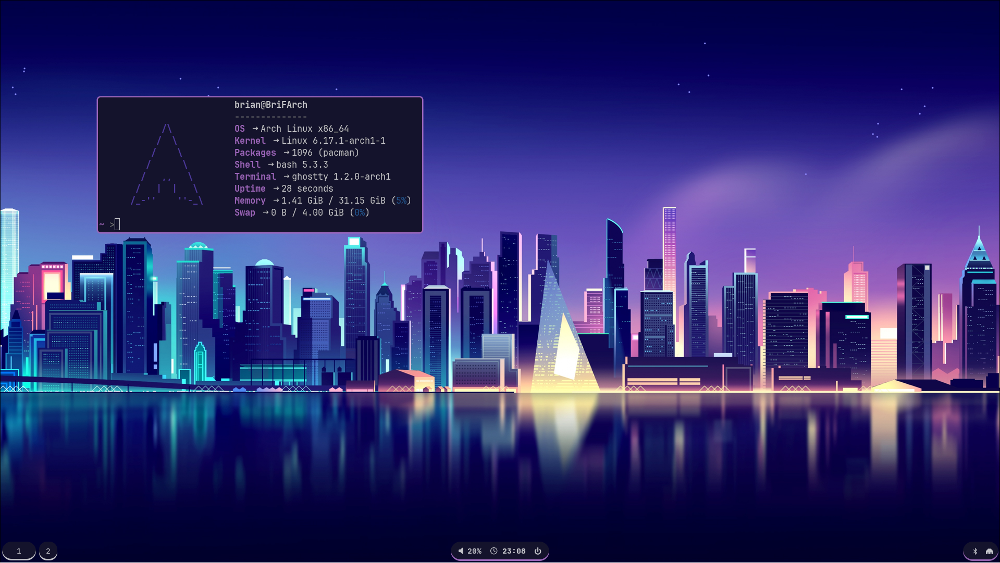
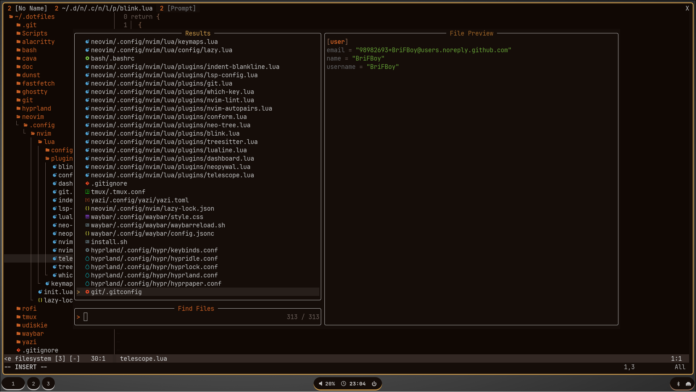

# BriFBoy's Dotfiles

Personal dotfiles for a Fedora + Hyprland setup. Not really meant to be used by
someone else, but the configs are managed with
[doty](https://github.com/BriFBoy/doty) (and the layout is still stow-compatible),
so it's easy to link just what you want.

Colors are generated by [pywal](https://dylanaraps.github.io/pywal/) from the
current wallpaper and applied to Hyprland with
[Noctalia](https://noctalia.kalmari.ghost/). A built in wallpaper switcher
(Super+W) re-themes everything.

## Stack

- **Desktop:** Hyprland (Lua config) + Noctalia + pywal, `ly` login and
  `hyprlock`/`hypridle`/`swww`/`wlogout`
- **Terminal:** Ghostty
- **Editor:** tmux + Neovim (work in progress)
- **Shell:** Bash (a Fish config is included too)
- **File manager:** yazi (run `y` in bash), dolphin
- **Bar / notifications:** Waybar, Dunst
- **Misc:** Rofi, Cava, Fastfetch, Starship, udiskie, Floorp

## Screenshots

The normal desktop


Screenshots of inside neovim


## Installation

The configs are managed with [doty](https://github.com/BriFBoy/doty). Link a
package into your home dir with `doty link <package>` (the layout is also
stow-compatible, so `stow <package>` works too). Each package has a `fedora.sh`
hook you can run with `doty install <package>` — they're no-op stubs for now.

The underlying apps (Hyprland, Ghostty, Waybar, …) are **not** installed by this
repo; install them with your package manager first.

### Step by step
Clone the repo and install doty:
```bash
  git clone --depth 1 https://github.com/BriFBoy/Dotfiles .dotfiles
  cd .dotfiles
  curl -fsSL https://raw.githubusercontent.com/BriFBoy/doty/master/install.sh | sh
```

Link the packages you want (one per call):
```bash
  doty link hyprland
  doty link ghostty
  doty link bash
  # … or with stow:  stow hyprland ghostty bash
```

Reboot (or restart your session) to apply the changes.

### Note
When logging into hyprland for the first time you will need to set the
wallpaper. You can do this by pressing Super+W and selecting a wallpaper.
